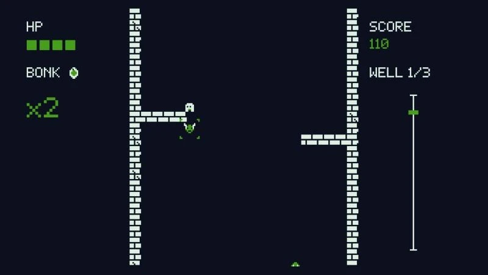

# Features

Babonk is a one-screen-wide pixel platformer down a vertical well. You fall, and you keep yourself up by bonking.

## Bonking

Press **BONK** in the air and you home in on the nearest foe below or beside you that nothing solid hides. With no foe in reach you dash the way you hold, or straight down if you hold nothing. Hitting a foe, a wall, a floor or a crate bounces you off it and gives the bonk back, so a good fall never touches the ground. Landing on a foe from above stomps it the same way. Touching the ground also gives the bonk back, but ends the chain.

## The chain

Each foe or crate you break adds one to the chain. Bare walls and floors keep you up but add nothing. A kill freezes the action for a few frames while the foe flashes, then it bursts; the longer the chain, the longer the freeze.

## Stars and points

Breaking a foe knocks stars out of it, one more for each kill already in the chain, up to five. A crate gives one. Stars bounce, drift to you when you're close, and blink out after a few seconds.

You score points for foes, crates and stars, a bonus for a chain of 3 or more when you land, and a bonus for each HP left at the bottom of a well. A score in the top ten asks for three initials.

## Wells

A run is three wells of set depth, each longer and meaner than the last. Wells are stacked from hand-made pieces, so every part is passable. Reach the bottom of a well and you rest and get +1 HP before the next one. Clear the third and you've won.

## HP

You have four HP. Foes and spikes take one, and you blink for a moment after. At none the run ends.

## Foes

- **Walkers** pace their ledge.
- **Floaters** drift until you come near, then stop with a "!", and chase you.
- **Spikers** can't be stomped, only bonked.

## The look and sound

The screen is 320 × 180, shown in big square pixels at the largest whole scale that fits the window, in three colours: a deep blue-black ground, pale mint, and a mid green for danger and reward. The soundtrack is chiptune, with a track for the title, each well, the rest, game over and the win.

## Pause and settings

Press `Esc` during a run for the pause menu: **Continue**, **Settings**, **Restart** and **Quit to title**. Restart and Quit to title ask first. Leaving the browser tab mid-run pauses the game. The settings cover volumes, the stick dead zone, brightness, full screen, screen shake, flashing and game speed; see [Settings](settings.md).
